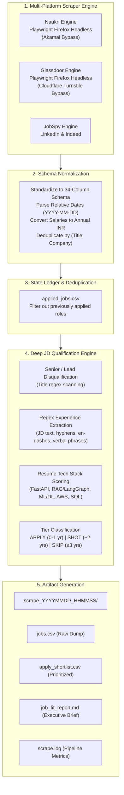

# Engineering Guide: How to Build This Job Scraping & Qualification Pipeline

This guide is an architectural and code-level blueprint explaining how to build this multi-board job scraping, NLP job-description qualification, and application-tracking pipeline from scratch.

---

## 1. System Architecture & High-Level Design

### The Core Engineering Challenge
Modern job seeking across platforms like LinkedIn, Indeed, Glassdoor, and Naukri suffers from three major technical roadblocks:
1. **Aggressive Anti-Bot Protections:** Modern platforms (especially Naukri.com protected by Akamai Bot Manager) detect and block standard automated HTTP requests and standard headless Chromium instances with `406 Recaptcha Required` or `403 Forbidden`.
2. **Sponsored Noise & Senior Bloat:** Over 85% of listings returned for queries like `"python"` or `"ai engineer"` are sponsored senior roles (3–10+ years experience).
3. **Deceptive Metadata:** Job card metadata frequently states `"0-3 years"` while the underlying Job Description (JD) text specifies `"6+ years of hands-on experience"`.

### Pipeline Architecture


---

## 2. Step-by-Step Implementation Guide

### Step 1: Building the Anti-Bot Naukri Scraper (`naukri_scraper.py`)

#### Why Standard Tools Fail on Naukri
* `python-jobspy` relies on hardcoded headers (`Nkparam`) that expired when Naukri migrated its frontend to Next.js.
* Naukri now generates client-side RSA-encrypted tokens (`v0|<timestamp>|121_srp`). Direct HTTP calls without this token return `406 Not Acceptable (recaptcha required)`.
* Headless Chromium triggers Akamai's CDP (Chrome DevTools Protocol) fingerprinting and canvas inspection, resulting in `403 Access Denied`.

#### The Solution: Playwright Firefox Headless
Playwright's Firefox engine bypasses Akamai's automation heuristics natively without requiring paid proxy networks or complex canvas patching.

#### Key Code Components:
1. **URL Construction & Freshness Enforcement:**
   Naukri defaults to relevance sorting (`sort=r`), which serves stale listings from 3–4 weeks ago. You must construct URLs with native freshness parameters:
   ```python
   # naukri_scraper.py
   def _build_naukri_url(search_term, location, page=1, hours_old=168, experience=0):
       term_slug = _slugify(search_term)
       loc_slug = _slugify(location) if location else None
       base = f"https://www.naukri.com/{term_slug}-jobs-in-{loc_slug}" if loc_slug else f"https://www.naukri.com/{term_slug}-jobs"
       if page > 1:
           base = f"{base}-{page}"
       
       # sort=f enforces Date Sort; jobAge enforces freshness window
       query_params = ["sort=f"]
       if hours_old:
           days = max(1, hours_old // 24)
           job_age = 1 if days <= 1 else (3 if days <= 3 else (7 if days <= 7 else (15 if days <= 15 else 30)))
           query_params.append(f"jobAge={job_age}")
       if experience is not None:
           query_params.append(f"experience={experience}")
       return f"{base}?{'&'.join(query_params)}"
   ```

2. **Relative Date Parser:**
   Naukri displays relative post dates (`"1 day ago"`, `"Few hours ago"`, `"30+ days ago"`). Convert these dynamically to ISO dates:
   ```python
   def _parse_relative_date(text: str) -> str:
       today = date.today()
       if not text or any(w in text.lower() for w in ["just now", "few hours", "today"]):
           return str(today)
       m_day = re.search(r"(\d+)\s*day", text.lower())
       if m_day:
           return str(today - timedelta(days=int(m_day.group(1))))
       m_week = re.search(r"(\d+)\s*week", text.lower())
       if m_week:
           return str(today - timedelta(days=int(m_week.group(1)) * 7))
       return str(today)
   ```

3. **DOM Card Extraction & 34-Column Schema Normalization:**
   Match JobSpy's output schema so that results from Indeed, LinkedIn, Glassdoor, and Naukri concatenate into a single pandas DataFrame:
   ```python
   cards = page.query_selector_all(".srp-jobtuple-wrapper, .cust-job-tuple")
   for c in cards:
       title = c.query_selector(".title").inner_text().strip()
       company = c.query_selector(".comp-name").inner_text().strip()
       job_url = c.query_selector("a.title").get_attribute("href")
       # map fields to JOBSPY_COLUMNS schema...
   ```

---

### Step 1.2: Building the Anti-Bot Glassdoor Scraper (`glassdoor_scraper.py`)

#### Why Standard HTTP Tools Fail on Glassdoor
* Direct TLS HTTP requests (such as `python-jobspy` using `tls-client` to `/findPopularLocationAjax.htm` or GraphQL `/graph`) trigger Cloudflare Turnstile bot detection (`<title>Security | Glassdoor</title>`, HTTP 403 Forbidden).
* Rapid subsequent navigations inside a single browser session accumulate session risk and re-trigger Cloudflare challenges.

#### The Solution: Isolated Playwright Firefox Sessions
1. **Fresh Context Isolation:** Each query is launched with a fresh browser context (`browser.new_context(...)`), resetting cookies and local storage to prevent session tracking.
2. **Modal Sheet Dismissal:** Glassdoor dynamically renders a sign-in dialog (`<dialog open="" aria-modal="true">`). Dismissing it immediately with `page.keyboard.press("Escape")` prevents UI interception.
3. **Single-Pass Card Extraction:** All critical fields (`job-title`, `employer-name`, `emp-location`, `detailSalary`, `job-age`, `descSnippet`) are extracted directly from the DOM cards in a single pass without triggering click events.
4. **Freshness Filtering:** The scraper dynamically converts Glassdoor relative timestamps (`"24h"`, `"3d"`, `"30d+"`) to ISO dates and drops stale/sponsored postings older than the configured threshold.

---

### Step 2: Deep JD NLP & Experience Extraction Engine (`run_scrape_and_fit.py`)

Simple keyword matching fails when companies use deceptive titles or bury high experience requirements inside paragraphs of JD text.

#### 1. Handling Unicode & Escape Variations
Text from scrapers frequently contains markdown escapes and unicode dashes:
* `5 \- 8 Yrs` (JobSpy markdown escape)
* `5 – 8 Yrs` (Unicode en-dash `\u2013`)
* `5 — 8 Yrs` (Unicode em-dash `\u2014`)

Normalize these characters before running regex:
```python
cleaned = str(text).replace("\\-", "-").replace("\\", "-")
```

#### 2. Comprehensive Numeric Experience Regex
Extract all minimum and maximum experience constraints using multi-pattern matching:
```python
def extract_experience_from_text(text: str) -> list[int]:
    if not text:
        return []
    cleaned = str(text).replace("\\-", "-").replace("\\", "-")
    exp_nums = []

    # Matches: '6+ years', '6+ yrs'
    for m in re.finditer(r'(\d+)\s*\+\s*(?:years?|yrs?)', cleaned, re.I):
        exp_nums.append(int(m.group(1)))

    # Matches: '1-3 years', '2 to 5 yrs', '5 – 10 Yrs'
    for m in re.finditer(r'(\d+)\s*(?:[-–—]|to)\s*(\d+)\s*(?:years?|yrs?)', cleaned, re.I):
        exp_nums.append(int(m.group(1)))
        exp_nums.append(int(m.group(2)))

    # Matches: 'minimum 3 years', 'at least 2 yrs'
    for m in re.finditer(r'(?:minimum|at\s+least|min\.?)\s*(?:of\s*)?(\d+)\s*(?:years?|yrs?)', cleaned, re.I):
        exp_nums.append(int(m.group(1)))

    # Matches: '6+ years of hands-on experience'
    for m in re.finditer(r'(\d+)\+?\s*(?:years?|yrs?)\s+(?:of\s+)?(?:\w+\s+){0,4}experience', cleaned, re.I):
        exp_nums.append(int(m.group(1)))

    return exp_nums
```

#### 3. Title Disqualification Filter
Immediately disqualify senior titles regardless of keyword matches:
```python
senior_keywords = ["senior", "sr.", "sr ", "lead", "principal", "architect", "staff", "manager", "director", "head", "vp"]
for w in senior_keywords:
    if re.search(r'\b' + re.escape(w) + r'\b', title.lower()):
        return "SKIP", "Senior Title", f"Disqualified: '{title}'"
```

#### 4. Tech Stack Alignment Matrix
Score alignment against the candidate's resume:
```python
has_python = "python" in combined_text
has_fastapi = "fastapi" in combined_text or "fast api" in combined_text
has_rag_genai = any(w in combined_text for w in ["langchain", "langgraph", "rag", "vector", "llm", "generative ai"])
has_ml_dl = any(w in combined_text for w in ["machine learning", "deep learning", "pytorch", "tensorflow"])
has_aws = any(w in combined_text for w in ["aws", "s3", "lambda", "redshift"])
has_db = any(w in combined_text for w in ["sql", "postgresql", "duckdb", "etl", "pipeline"])
```

#### 5. Tier Segregation Logic
* **`APPLY` (Priority):** Experience strictly $\le 1$ year OR explicitly tagged Fresher/Junior/Intern/Associate with strong tech stack alignment.
* **`SHOT` (Reach):** Experience requires $\sim 2$ years or unspecified, where strong deployed projects (`predmma.in`, LangGraph agents, FastAPI APIs) bridge the gap.
* **`SKIP`:** Demands $\ge 3$ years, senior title, non-technical role, or posted $> 7$ days ago.

---

### Step 3: Application Tracking & State Persistence (`applied_jobs.csv` & `track_applications.py`)

A common flaw in scrapers is recommending jobs the user has already applied to.

1. **Central State Ledger (`applied_jobs.csv`):**
   Stores `applied_date`, `company`, `title`, `site`, `location`, `status`, and `job_url`.
2. **Scraper De-Duplication Integration:**
   `run_scrape_and_fit.py` loads `applied_jobs.csv` at startup. Any job whose URL or `(company, title)` exists in the tracker is tagged `Already Applied` and skipped.
3. **CLI Management Tool (`track_applications.py`):**
   Allows listing applied jobs, updating interview stages (`Applied` $\rightarrow$ `Interview` $\rightarrow$ `Offer`), and viewing pipeline metrics.

---

### Step 4: Folder Architecture & Run Artifacts

Every execution creates an isolated timestamped directory:
```
scrape_YYYYMMDD_HHMMSS/
├── jobs.csv              # Full raw dump across all boards (34 columns)
├── apply_shortlist.csv   # Filtered early-career jobs with tier, status, why
├── job_fit_report.md     # Executive report categorized by domain
└── scrape.log            # Execution stdout and platform statistics
```

This guarantees reproducibility and allows comparing market shifts week-over-week.
